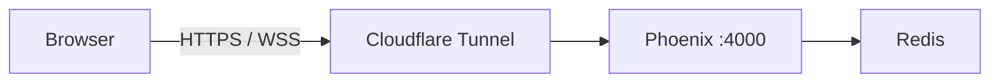

# System overview

- **UI:** Phoenix templates plus Elm (`Game.elm`, `GameSettings.elm`).
- **Realtime:** Phoenix channels over websocket; game JSON compressed with lz-string.
- **Game state:** Redis keys `game:<id>`, removed after 24 hours idle.
- **`/user` extras:** Not stored on the server. Settings and history stay in `localStorage`. See [Game state](game-state.md) for Redis, compression, and multiplayer.
